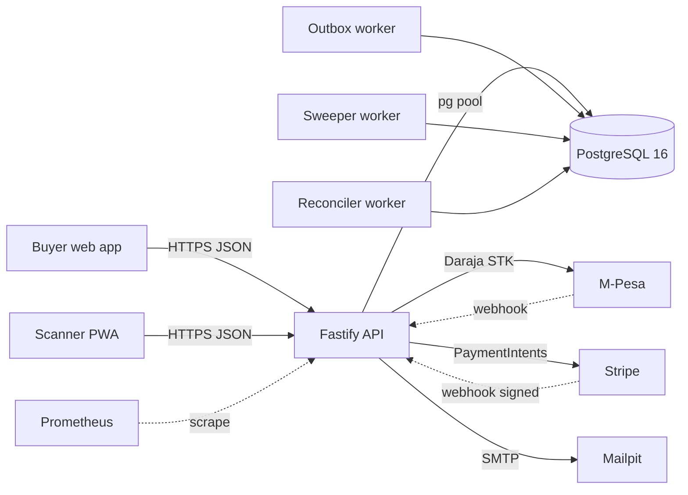

# Ticketing Platform

A production-shaped event ticketing system built to demonstrate **transactional correctness under concurrency**. The whole project exists to answer one question: *can you sell the last ten tickets to exactly ten people when a thousand are trying to buy at the same instant?*

- **No overselling** — inventory is enforced by a `CHECK (sold + reserved <= capacity)` constraint and an atomic conditional UPDATE predicate. If the application layer has a bug, the database refuses the write.
- **No double-charging** — every payment is keyed by an idempotency key at both the client and the provider. Replaying a webhook ten times produces one state change.
- **No duplicate tickets** — every ticket row carries `UNIQUE (order_item_id, serial_no)`. The outbox worker can retry a hundred times and the count never drifts.

Stack: Node 20 · TypeScript (strict) · Fastify · PostgreSQL 16 · `pg` (raw SQL, no ORM) · React · Vite · TanStack Query · Tailwind · Vitest · k6 · Docker Compose.

---

## Architecture



Three background workers run inside the API process:

| Worker | Interval | Responsibility |
|---|---|---|
| **Sweeper** | 5 s | Expires `awaiting_payment` orders past their `expires_at` and releases reserved inventory. Uses `FOR UPDATE SKIP LOCKED` so multiple replicas partition work. |
| **Outbox publisher** | 2 s | Drains `outbox_events`: issues tickets, sends email. Every handler is idempotent. |
| **Payment reconciler** | 30 s | Drains orphan webhook events and queries provider status for payments stuck in `initiated` > 2 min. |

Postgres is the only source of truth. Nothing in the request path reads cache-as-inventory or trusts a client-supplied price, quantity, or total.

---

## Local setup

Prereqs: Node 20+, Docker Desktop (or colima), `mkcert` for phone testing.

```bash
git clone https://github.com/<you>/ticketing-platform
cd ticketing-platform
cp .env.example .env

# Generate a JWT secret (>= 32 chars, config rejects shorter)
JWT_SECRET=$(node -e "console.log(require('crypto').randomBytes(48).toString('base64url'))")
printf '\nJWT_SECRET=%s\n' "$JWT_SECRET" >> .env

npm install
npm run db:up            # Postgres 16 + pgAdmin + Mailpit
docker compose ps        # wait for ticketing-db (healthy)
npm run migrate          # 0001..0006
npm run dev              # API :3000, web :5173
```

Health checks:

```bash
curl -s localhost:3000/health          # {"status":"ok"}
curl -s localhost:3000/health/ready    # {"status":"ready"}
open http://localhost:5173             # event list
open http://localhost:8025             # Mailpit (outbound email)
open http://localhost:5050             # pgAdmin (admin@local.dev / admin)
```

HTTPS for the scanner PWA on your phone:

```bash
mkcert -install
mkdir -p apps/web/.cert && cd apps/web/.cert
mkcert -key-file key.pem -cert-file cert.pem \
  localhost 127.0.0.1 ::1 "$(ipconfig getifaddr en0)"
```

Open `https://<your-lan-ip>:5173/scan?eventId=<uuid>` on the phone and accept the certificate profile.

---

## API reference

| Method | Path | Auth | Purpose |
|---|---|---|---|
| `POST` | `/auth/register` | — | Create organizer / attendee / staff account |
| `POST` | `/auth/login` | — | Email + password → JWT |
| `GET` | `/auth/me` | any | Current user |
| `GET` | `/events` | — | Public list of published events with live availability |
| `GET` | `/events/:id` | — | Event detail with tiers |
| `POST` | `/events` | organizer | Create event (draft) |
| `PATCH` | `/events/:id` | organizer | Update event |
| `POST` | `/events/:id/publish` | organizer | `draft → published` |
| `POST` | `/events/:id/cancel` | organizer | `draft\|published → cancelled` |
| `POST` | `/events/:id/tiers` | organizer | Create tier |
| `PATCH` | `/tiers/:tierId` | organizer | Update tier (capacity, price, sales window) |
| `POST` | `/orders` | attendee | Reserve inventory. Requires `Idempotency-Key` header |
| `GET` | `/orders/:id` | owner | Order detail with `latestPayment` |
| `POST` | `/orders/:id/pay` | owner | Initiate M-Pesa STK Push. Requires `Idempotency-Key` |
| `GET` | `/payments/:id` | owner | Payment detail |
| `POST` | `/webhooks/mpesa` | — | Daraja STK callback (unauthenticated, deduped) |
| `POST` | `/webhooks/stripe` | — | Stripe event (HMAC verified) |
| `GET` | `/tickets` | attendee | Buyer's tickets |
| `GET` | `/tickets/:id` | owner | Single ticket |
| `GET` | `/tickets/:id/qr` | owner | QR image (SVG default, `?format=png`) |
| `POST` | `/tickets/:id/void` | organizer | Void a ticket |
| `POST` | `/checkin` | staff | Single scan |
| `POST` | `/checkin/sync` | staff | Batch of offline scans |
| `GET` | `/events/:id/checkin-manifest` | staff | Offline verification payload |
| `GET` | `/events/:id/checkin-stats` | staff | Live checked-in / total |
| `GET` | `/metrics` | token | Prometheus metrics |

Every non-2xx response is `{ error: { code, message, details? } }`.

---

## Concurrency test suite

The centerpiece. Six tests prove correctness under specific races against a real Postgres instance — no mocks.

```bash
# All concurrency tests
npm test --workspace=@ticketing/api -- concurrency

# One at a time
npm test --workspace=@ticketing/api -- 01-oversell
npm test --workspace=@ticketing/api -- 02-deadlock
npm test --workspace=@ticketing/api -- 03-idempotency
npm test --workspace=@ticketing/api -- 04-webhook-replay
npm test --workspace=@ticketing/api -- 05-expiry-race
npm test --workspace=@ticketing/api -- 06-checkin-race

# The naive-implementation comparison
npm test --workspace=@ticketing/api -- 01-oversell -t naive

# k6 load test — 1000 VUs on a tier with capacity 10
brew install k6
npm run dev:api &        # in another terminal
k6 run apps/api/test/load/k6-buyers.js
```

Each test finishes with `checkInvariants()`, a whole-DB audit that fails on any of six violation classes: tier counter bounds, paid-without-payment, ticket count mismatch, duplicate scans, ticket status consistency, orphan payments.

## Screenshots

| Screen | Description |
|---|---|
| `docs/screens/event-list.png` | Public event list with availability badge |
| `docs/screens/event-detail.png` | Tier selector with live refresh |
| `docs/screens/checkout.png` | Countdown timer and M-Pesa phone input |
| `docs/screens/pending.png` | "Check your phone" state |
| `docs/screens/success.png` | Ticket cards with QR codes |
| `docs/screens/scanner.png` | Full-screen scanner with green overlay |
| `docs/screens/k6.png` | k6 summary showing `orders_created: 10` |
| `docs/screens/naive.png` | Naive test log: `capacity=10 reserved=17 → oversold by 7` |

---

## Project layout

```
apps/
  api/                Fastify server, workers, migrations
    src/
      db/             pool + withTransaction helper
      services/       orders, inventory, payments, tickets, checkin
      payments/       PaymentProvider interface + M-Pesa + Stripe
      qr/             HMAC signing, key rotation, PNG/SVG generator
      workers/        sweeper, outbox, reconciler, metrics sampler
    test/
      concurrency/    The six proof tests
      load/           k6 script
  web/                React SPA + scanner PWA
packages/
  shared/             Zod schemas and enums shared by API and web
migrations/           Plain SQL, applied in order, checksummed
scripts/migrate.ts    Migration runner
```

## License

MIT.